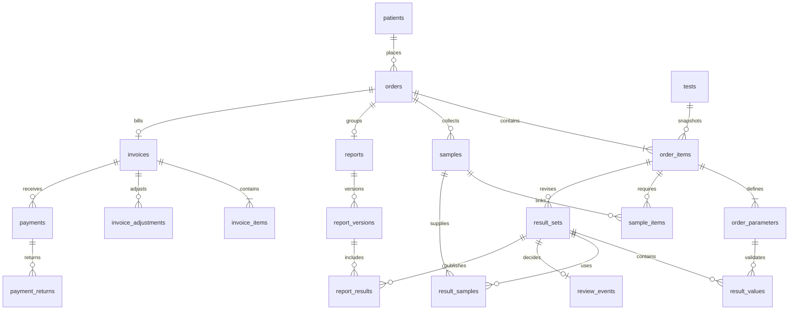

# Database schema — v0.1 through v1.0

**Updated:** 2026-11-07  
**Status:** Complete planned schema coverage for the release roadmap. No SQL migrations or database acceptance tests have been implemented.

One customer installation has one PostgreSQL database. Each release adds to the prior schema; local and VPS installations use the same structure. This index is the starting point. Per-version files define columns, constraints, indexes, transactions and verification requirements.

## Schema by version

| Version | Tables added / changed | Detailed design |
| --- | --- | --- |
| v0.1 | lab_settings, users, user_roles, sessions, account_tokens, audit_events, schema_migrations | [Foundation schema](database/V0.1.md) |
| v0.2 | number_counters, patients, patient_changes, specimen_types, tests, test_parameters, parameter_choices, reference_ranges, panels, panel_items, orders, order_items, order_parameters, samples, sample_items, sample_events | [Patients, orders and samples](database/V0.2.md) |
| v0.3 | stored_files, result_sets, result_values, result_samples, review_events, reports, report_versions, report_results; lab_settings logo reference migration | [Results and reports](database/V0.3.md) |
| v0.4 | user_permissions, invoices, invoice_items, invoice_adjustments, payments, payment_returns, receipts, idempotency_records | [Billing and payments](database/V0.4.md) |
| v0.5 | Explicit lab policy columns and reporting queries/views; reuse staff/settings/audit tables | [Administration](database/V0.5-V1.0.md#v05-schema-changes) |
| v1.0 | Cumulative schema verification, upgrades, backups, restore and measured index changes | [Operational gate](database/V0.5-V1.0.md#v10-database-and-operational-gate) |

There are 39 planned tables by v0.4. v0.5 and v1.0 do not add tables merely to match a release number. SQL views and indexes are distinct from domain tables.

## Main relationships

This is a workflow relationship map. Detailed FK/uniqueness rules are in the version files; minimum child counts such as an order's required items are enforced transactionally.

## Schema notation

The v0.1 file lists every column directly. Later tables use these base definitions to avoid repetition:

| Base | Included columns and behavior |
| --- | --- |
| M — mutable | id uuid PK; created_at timestamptz DEFAULT CURRENT_TIMESTAMP; updated_at timestamptz DEFAULT CURRENT_TIMESTAMP; row_version bigint DEFAULT 1 CHECK > 0 |
| I — immutable/event | id uuid PK; created_at timestamptz DEFAULT CURRENT_TIMESTAMP |
| None | All columns and primary keys are stated explicitly |

Required unless marked **?** or nullable. UUIDs are generated by trusted application code, no database default required. Unspecified defaults do not exist. Mutable updates use expected row_version; triggers increment it and set updated_at. Primary keys and created_at cannot change.

Every arrow denotes a foreign key with ON DELETE RESTRICT / ON UPDATE RESTRICT. Explicit UNIQUE constraints create indexes. Required text is trimmed/nonempty; optional text is NULL or trimmed/nonempty. Unless a version file says otherwise, names/display text/unit labels are limited to 200 characters, codes to 40, reasons/descriptions to 1000 and statuses to their enumerated values. JSON object/array types require database CHECKs; their exact field contracts are validated by the server before writing. Never put secrets in clinical snapshots.

Base I denotes immutable content, except explicitly managed catalog composition and permission membership rows: panel_items and user_permissions may be replaced/deleted through audited authorized transactions. All other I tables are append-only for ordinary runtime. M permits only documented edits; approved/submitted results, issued invoice content and released artifacts remain frozen despite their mutable state metadata.

Store timestamps in UTC, interpret business dates through lab timezone and use date for birth dates. Money uses finite numeric(14,2); clinical numeric values use finite numeric(24,8), with application validation before database rounding. Amounts cross JSON boundaries as decimal strings. Database IDs and readable business numbers serve different purposes.

## Integrity boundaries

- **Database constraints/triggers:** row types, CHECKs, FK ownership, uniqueness, immutable content and deferred aggregate/state checks explicitly specified per module.
- **Transaction services:** cross-row invariants, workflow transitions, matching specimen/parameter context, authorization, snapshot construction, locked numbering and money calculations.
- **Clinical confirmation:** reference values, range selection assumptions, reviewer eligibility and release policies must be validated by the pilot lab.
- **Deployment:** isolated credentials/storage, migrations, encrypted backups, file integrity and one writable installation during cutover.

Authorization and audit rules from v0.1 apply to every module. No version may postpone permission checks or history protection to v1.0.

## Global transaction order

For idempotent financial requests, acquire the actor/key advisory lock first. Then acquire any required settings row, user rows in UUID order, catalog parent rows when needed, orders, order_items, samples, result/report or invoice/payment records, and finally numbering counters. Within each group lock UUIDs consistently. Do not acquire an earlier group after a later one.

A service may skip groups it does not need. It must recheck current permissions and dependency state after locking. Report publication takes order/item locks before report/version locks, so it cannot invert clinical mutation order. Database/file work uses staged publication and reconciliation, not an assumed distributed transaction.

## Design decisions

- Independent single-lab databases; no registry, tenant switching or subscription tables.
- Test panels group tests and sum member prices. Each ordered item is one test occurrence.
- Numeric, text and choice results are supported; automatic interpretation is limited to configured range flags.
- Results are approved as a versioned set per ordered test; rejected or amended work creates another revision.
- Reports freeze rendering inputs and bytes. Financial documents freeze line prices and receipt snapshots.
- Each order has at most one issued invoice; later amount changes are explicit debit/credit adjustments.
- Partial payments/refunds/reversals remain traceable. Balances are derived from immutable ledger records.
- Two-decimal currencies are the MVP boundary. Client clinical values and retention periods are not invented by this design.

The [release specifications](RELEASE-SPECIFICATIONS.md) map this schema to behavior and acceptance. The [roadmap](VERSION-ROADMAP.md) defines delivery order; the [checklist](MVP-CHECKLIST.md) records progress. Changes to this design must update the affected version file before migrations are implemented.
